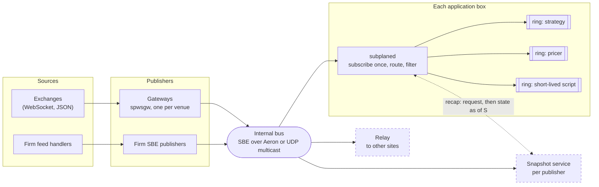
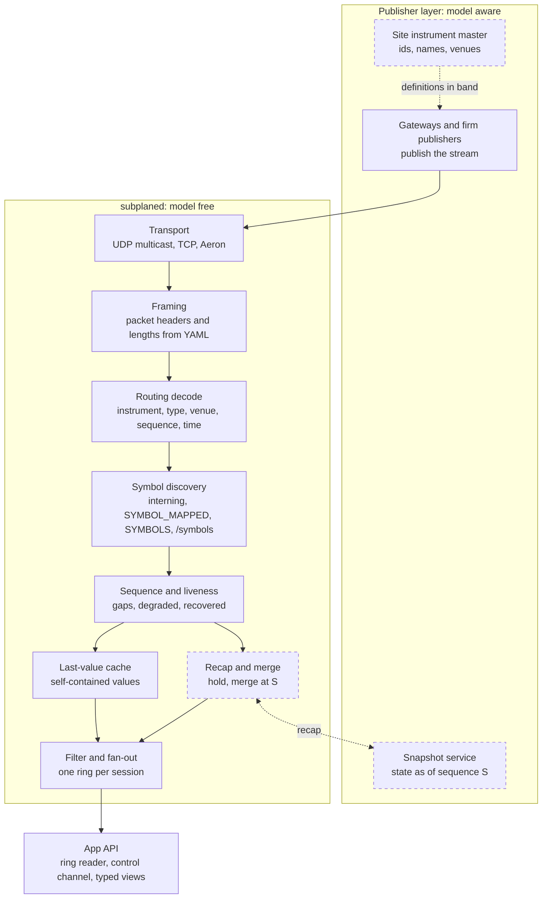
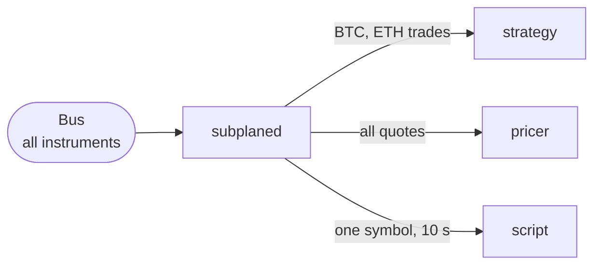
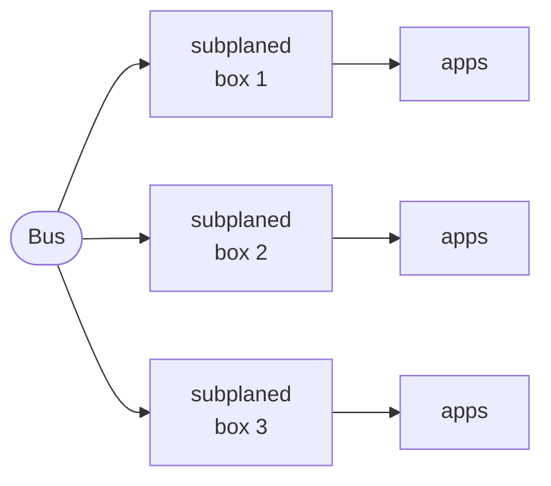
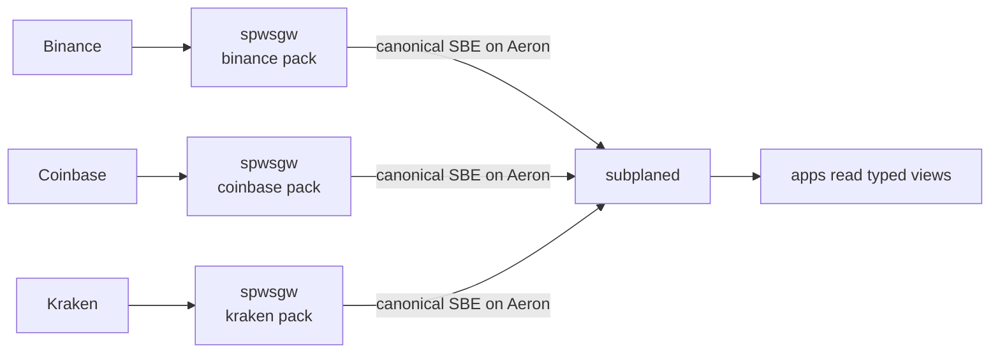
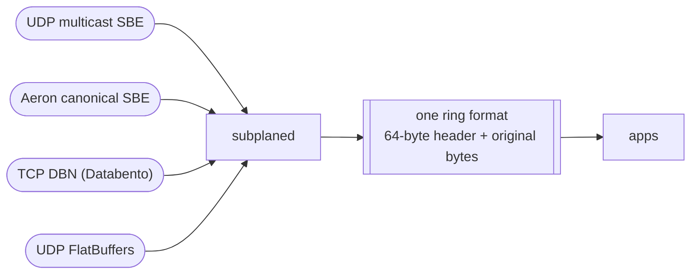
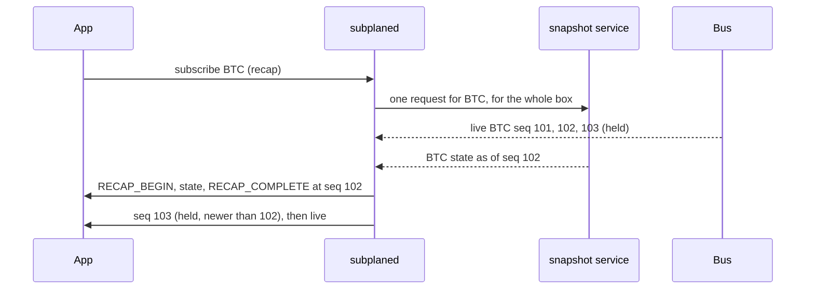
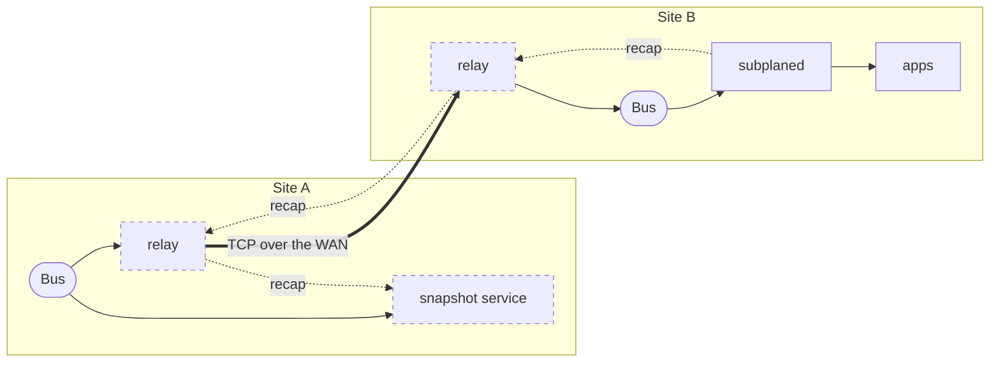
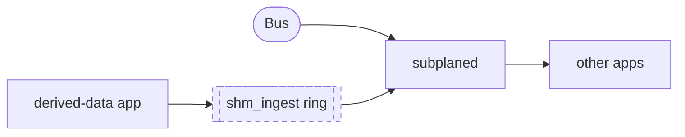

# subplane

The subscription plane under your market data apps: a single-binary routing agent (`subplaned`) for an internal SBE bus. One instance runs on each application box. It subscribes to the bus over UDP multicast, finds message boundaries from the published SBE schema, decodes only the routing fields, filters per application, and fans the original SBE bytes out through shared-memory rings. Apps decode SBE with their own codecs and stop doing deserialization, filtering and routing.

It is not a decoder and not a broker. The only hard requirement on a publisher is its SBE schema.

```
firm feed handler -> internal bus (SBE) -> subplane (per box) -> shared-memory ring per app session -> apps
```

## Why it exists

A trading box runs a handful of applications, and every one of them needs market data. Without an agent, each app does the same work on its own:

- subscribes to the bus and receives every message, including the ones it will throw away;
- decodes enough of each message to know what it is and which instrument it is about;
- filters down to the instruments and message types it cares about;
- tracks sequence numbers, detects gaps, handles restarts and late joins;
- carries code for the bus's transport and encoding, so a new bus or a new encoding means changes in every app.

Ten apps on a box means ten subscriptions, ten decoders, ten filters and ten slightly different gap handlers. The cost is paid again every time a short-lived worker starts, and every app team maintains plumbing that has nothing to do with their strategy.

subplane does that work once per box:

- **One subscription per box.** The agent joins the bus, the apps do not.
- **Routing, not decoding.** It reads only the fields needed to route (instrument, message type, sequence, timestamp) and leaves the message bytes untouched.
- **A filtered ring per app.** Each app reads a shared-memory ring that holds only the messages it asked for, bit-identical to what the bus carried, plus in-band events for gaps, restarts and snapshots.
- **One contract for every bus.** Which transport, encoding and framing the bus uses is agent configuration. Apps on a UDP SBE bus, a TCP DBN stream or a FlatBuffers feed read rings the same way, and typed views let them read fields without a codec when they want one.

What it deliberately is not: a decoder (apps keep their own codecs and full decode), a broker (data flows one way, nothing routed back to a producer, nothing across hosts; recap requests go upstream only to a declared snapshot service, and cross-site cascading is a separate relay process, planned), or a feed handler (no exchange protocols). Keeping the core to subscribe, route and fan out is what lets it stay small and fast, and lets everything else vary behind the one contract.

## What it takes off a market data team

Low-latency market data usually means hiring for the same list: Linux and network programming, CPU architecture, exchange protocols, profiling, packet capture and replay, threads and lock-free code. Most of what those engineers build first is the same plumbing at every firm. subplane and [subplane-feeds](https://github.com/CognitoHQ/subplane-feeds) build it once, in the open, so a team's time goes to what sets it apart.

| Skill | Built once here | Still yours |
|---|---|---|
| Linux, network programming, CPU | `recvmmsg` batches, optional busy-poll and kernel receive timestamps, shared-memory rings and core pinning, all inside the agent. Apps include one header-only reader. | Tuning the box: IRQ affinity, isolated cores, NIC settings. Kernel bypass (Onload, ef_vi, DPDK) is not built; the budget is tens of microseconds on kernel sockets. |
| Market data protocols | Message boundaries and lengths from the published SBE schema, with no hand-written handler per message; DBN and FlatBuffers routed the same way. Exchange WebSocket feeds (Binance, Coinbase, Kraken, Bitstamp, OKX) normalized to one canonical schema by YAML packs. Gaps, publisher restarts, late join and book recap handled by the agent and a snapshot service. | Order entry: out of scope, since data flows one way. A venue without a pack: a pack is YAML, not a new handler. |
| Profiling and optimization | Apps stop decoding, filtering and routing, so that cost leaves them. Every hop is measured: latency histograms and counters on `/metrics` (Prometheus), the data flow on `/topology`, and `subplane replay --bench` for the pipeline in process. | Your strategy code. |
| Packet capture, dissection and replay | `subplane probe` checks a framing description against live packets, `subplane replay --pcap` puts a capture back on the wire, `subplane tail` prints a ring, and gateways record and replay their input byte for byte. A recorder of ring records, replayed through the agent so apps run unmodified against history, is planned. | |
| Threads and lock-free code | Single-writer rings and one-writer counters, written and tested once. An app polls its own ring, and a slow app overruns only itself. | Concurrency inside your apps. |

### Build on it

- **A new exchange:** write a pack (`docs/pack-format.md` in subplane-feeds).
- **A new bus, transport or encoding:** `docs/guides/custom-integration.md`.
- **An app, a consumer or a function runtime:** `docs/guides/app-developer.md`.
- **A gateway or a snapshot service, in any language:** the subplane protocol, `docs/protocol/developer-guide.md`.

## The whole picture

subplane is turning into a complete publish/subscribe layer for market data, with the application's API at its centre. Publishers put SBE on a bus; one agent per box subscribes once and hands each app only what it asked for; recovery and cross-site delivery are separate, declared services. Solid boxes are built today; dashed boxes are planned.



Apps subscribe through the agent's API; they never join the bus, never decode what they do not want, and never learn which transport or encoding the bus uses. Publishing from an app box goes through `shm_ingest` (planned), not through the agent's fan-out.

## Layers

Inside the agent, every message passes the same layers in order. The publisher layer beside it is the only place that knows what the data means. Solid is built; dashed is planned.



### Symbol discovery

There are three names for one instrument, and an app needs to know which one it holds:

| Name | Assigned by | Where an app sees it |
|---|---|---|
| Publisher id (`InstrumentId`, `SecurityID`) | the publisher, ideally from a site instrument master | in the payload |
| `symbol_id` | the agent, dense, stable only within one agent epoch | in every record header |
| Human name (`BTCUSDT`) | the publisher | in instrument definition messages |

How an app learns them today:
- **In band:** `SYMBOL_MAPPED` arrives on the ring the first time the agent sees an instrument, before its first data record.
- **On request:** the control channel `SYMBOLS` op and `GET /symbols` page through id to name pairs; `HELLO` reports how many there are.
- **Definitions:** instrument definitions have their own message type (`DEFINITION`), so the last-value cache keeps each instrument's latest definition and a late joiner can read it.
- **Ids from two venues:** `symbol_scope: venue` keeps the same integer id from two venues apart, spelled `10:1` in filters and names.

Planned: the agent binds the publisher id to the human name it reads from definition messages, so `SYMBOL_MAPPED` says `BTCUSDT` instead of `1` and a session can filter by name. The agent never invents symbology; the publisher layer (a site instrument master) owns it, and the agent indexes what it is given.

### Last-value cache

The cache holds one record per instrument and message type, for values where the newest message is the whole state: instrument definition, trading status, last quote, last trade. A late joiner reads it over the control channel (`SNAPSHOT`, or `GET /lvc/{symbol}?type=` for an operator), seeds its state, and tails the ring. It never holds a book or an accumulated value such as session volume: those are built from many messages with the publisher's rules, and come from the publisher's snapshot service through recap (planned).

## Deployment patterns

| You have | Pattern | Status |
|---|---|---|
| A bus and several apps on one box | [1. One box](#1-one-box-one-subscription) | built |
| The same bus on many boxes | [2. Many boxes](#2-many-boxes) | built |
| Exchanges that speak WebSocket and JSON | [3. Gateways](#3-exchanges-through-gateways) | built (five crypto venues) |
| Several buses or encodings | [4. Mixed sources](#4-mixed-sources-one-contract) | built |
| Apps that start late, restart or miss data | [5. Late join and recovery](#5-late-join-and-recovery) | last value built, recap planned |
| Apps at another site | [6. Across sites](#6-across-sites) | planned |
| Derived data produced on the box | [7. Publishing on the box](#7-publishing-on-the-box) | planned |

### 1. One box, one subscription

Every app on the box used to join the bus, receive everything and throw most of it away. Now the agent joins once and each app reads a ring holding only its instruments and message types, bit-identical to the bus, with gaps and restarts as in-band events.



### 2. Many boxes

The bus fans out to boxes; the agent fans out to apps. Cost on a box stays flat as apps are added, because filtering and gap handling happen once per box.



### 3. Exchanges through gateways

A gateway holds the one exchange connection, maps the venue's JSON to the canonical SBE schema, keeps books in sync, and publishes on Aeron. The agent treats it like any other bus partition. Gateways live in the sister repository `subplane-feeds` (`spwsgw`, with packs for Binance, Coinbase, Kraken, Bitstamp and OKX).



### 4. Mixed sources, one contract

Transport, framing and encoding are per-partition configuration. One agent can take UDP multicast SBE, Aeron, a TCP DBN stream and FlatBuffers at once, and every app reads rings the same way.



### 5. Late join and recovery

Two paths, chosen by what the state is:

- **Self-contained values** (instrument definition, trading status, last quote, last trade): the newest message is the whole state. The agent's last-value cache serves it over the control channel; the app seeds from it and tails the ring. Built.
- **State built from many messages** (books, session volume, VWAP): the publisher's sister snapshot service holds it. The agent asks once per symbol for its whole box, holds that symbol's live messages for the waiting apps only, and merges the reply by sequence. Built: the agent side, and the snapshot service for the crypto gateways in [subplane-feeds](https://github.com/CognitoHQ/subplane-feeds).



The publisher only publishes; it never sees a recap request. See "Recovery: recap" in `docs/context/project-vision.md`.

### 6. Across sites

A relay tunnels the bus between sites: Aeron in, TCP across the WAN, Aeron out at the far site, bytes and sequence numbers untouched. Each site's agents subscribe as usual. A relay can also answer recaps for the sites below it, so each level asks upstream once. Planned.



### 7. Publishing on the box

A local app writes one-way into a ring the agent reads as just another partition, so derived data (signals, fair values) reaches every other app on the box over the same contract. Planned (`shm_ingest`).



## Quick start

Needs Docker: `scripts/dev.sh` builds and runs everything in the toolchain image (`docker/Dockerfile`: Ubuntu 26.04, GCC 16, C++26; INV-007), built on first use. On an Ubuntu 26.04 host, `sudo scripts/deps-2604.sh` installs the same toolchain and the commands below work without the image. The Aeron C client and media driver are fetched and built at configure time (`cmake/aeron.cmake`, pinned tag, no Java); `-DSUBPLANE_WITH_AERON=OFF` drops the fetch and the `aeron` transport.

```bash
scripts/dev.sh test       # build ./build and run ctest, in the image
scripts/dev.sh shell      # the binaries need 26.04's glibc: run the rest inside it

# Local demo config: unicast instead of multicast, so no network setup is needed.
sed -e 's/group: 239.1.1.1/group: ""/' -e "s#schema: schemas#schema: $PWD/schemas#" config.yaml > /tmp/ft.yaml

build/subplaned --config /tmp/ft.yaml &

# Synthetic publisher, using the same framing as config.yaml.
FRAMING='{packet_header: [{name: seq, type: u64le}, {name: count, type: u16le}], message_prefix: [{name: len, type: u16le}], sequence: packet_header.seq, length: message_prefix.len}'
build/tools/subplane send --port 30001 --framing "$FRAMING" --rate 1000 --per-packet 3 &

curl -s localhost:8080/status
build/tools/subplane tail /dev/shm/subplane.subplane.alpha.ring --from-start --count 10
build/examples/shm_demo_app --socket /tmp/subplane.sock --session demo --seconds 5
```

The control socket is `/run/subplane/subplane.sock` if that directory is writable, otherwise `/tmp/subplane.sock`; the agent logs which one it bound. `GETTING_STARTED.md` walks through this step by step.

## Consumption models

One contract serves three kinds of consumer. Each has a runnable example that depends only on the two client headers.

| Workload | What the agent gives it | Example |
|---|---|---|
| Resident app (strategy, pricer) | A filtered session, snapshot for late join, ordered ring with in-band gap and restart events | `examples/shm_demo_app.cpp` |
| Elastic or short-lived worker (burst jobs, pods, scale-to-zero, blue/green) | Per-box costs paid once and kept warm; a new instance is one control round trip plus a ring file, live with state in milliseconds | `shm_demo_app --seconds N`, several at once |
| Function-style runtime (alerting rules, per-symbol shards, side channels) | Filter as trigger spec, ring as a replayable event log, snapshot as initial context | `examples/rule_runner.cpp` |

```bash
# elastic workers: three short-lived sessions side by side
for i in 1 2 3; do build/examples/shm_demo_app --socket /tmp/subplane.sock --session w$i --trades-only --quiet --seconds 10 & done
curl -s localhost:8080/sessions

# function runtime: dry-run the rules on ring history, then go live
build/examples/rule_runner --socket /tmp/subplane.sock --from-start --seconds 10
```

`docs/context/project-vision.md` ("Consumption models") explains each case and its current limits. Transports, framing and routing are agent configuration, not application code: apps never learn which bus they are on.

## Documentation

Read one file, the one for your task. `docs/README.md` is the map; coding agents start at `AGENTS.md`.

| I want to | Read |
|---|---|
| try it on one machine | `GETTING_STARTED.md` |
| deploy a known-good setup (crypto exchanges, a firm SBE bus) | `docs/guides/deploy-reference.md` |
| write an app that consumes data | `docs/guides/app-developer.md` |
| run and monitor agents and gateways | `docs/guides/operator.md` |
| connect my own bus, publish my own data, design a schema | `docs/guides/custom-integration.md` |
| write a gateway or snapshot service | `docs/protocol/developer-guide.md` |
| the full reference: formats, configuration, contracts | `docs/context/architecture.md`, `docs/context/observability.md`, `docs/protocol/subplane-protocol.md` |

`skills/subplane-schema-designer/` is a Claude Code skill for designing schemas and SPP extensions the subplane way. It is active in this repo through `.claude/skills/`; elsewhere, copy the directory to `~/.claude/skills/`.

Everything in the docs is implemented unless marked "(planned)".

## Checked against real packets

`scripts/fetch-cme-sample.sh` downloads 27 public CME MDP 3.0 packets and CME's schema (v9 and v13), and `ctest -R cme_probe` replays them through the production framer and schema walker with a framing block written from CME's documentation. Every message length from the schema walk matches the wire. The test skips when the sample has not been fetched.

A second encoding over a second transport: `decoder: {type: dbn}` with `transport: {type: tcp_stream}` consumes Databento DBN records (Databento's live gateway framing: prelude, metadata, records). `build/tools/subplane dbn-sim --port 9550 --synthetic` serves synthetic records, or `--file x.dbn` replays a real file; `ctest -R dbn_sim` runs the synthetic version end to end. The commented `db-p0` partition in `config.yaml` is the configuration.

A third transport, Aeron: `transport: {type: aeron, channel: "aeron:ipc", stream_id: 1001}` subscribes to an Aeron stream (IPC, UDP unicast or multicast) and treats each message as a packet; `driver: {embedded: true}` runs the media driver inside the agent, or point `aeron_dir` at a running `aeronmd`. `build/tools/subplane aeron-pub` publishes canonical messages; `ctest -R aeron` runs it through the agent over IPC and over UDP loopback. The commented `canonical_aeron` partition in `config.yaml` is the configuration.

A third encoding with no library: `decoder: {type: flatbuffers}` routes FlatBuffers by field id straight off the wire and delivers the whole buffer, size prefix included. `ctest -R flatbuffers` runs real `flatc` output (`tests/fixtures/flatbuffers/`) through the decoder and over UDP through the agent. The commented `fb-p0` partition in `config.yaml` is the configuration.

## Typed views without a codec

A flat SBE message (no groups, no varData) is a fixed block behind the 8-byte message header. `subplane schema` turns the schema the agent loads into typed access to that block in three languages, so an app never links a codec or runs a code generator of its own:

```bash
build/tools/subplane schema --schema schemas/sample_md.xml --views all --out out/
# wrote out/sample_md_views.h  out/sample_md_views.py  out/sample_md_views.q
# emitted Trade, Quote, Ticker, Heartbeat, SeqReset; skipped BookUpdate: has groups (Levels)
```

**C++.** A message whose fields are all naturally aligned becomes a plain struct, and the `static_assert`s are the proof that it is the wire layout. A message with a misaligned field (SBE does not pad) becomes a view class with `memcpy` accessors instead. There is never a `#pragma pack`.

```cpp
// out/sample_md_views.h (generated)
struct Ticker {
    static constexpr bool kIsStruct = true;
    static constexpr uint16_t kTemplateId = 4;
    static constexpr size_t kSize = 32;
    uint16_t blockLength;
    uint16_t templateId;
    uint16_t schemaId;
    uint16_t version;
    char Symbol[8];  // Symbol8
    uint64_t SeqNum;
    uint64_t TransactTime;
};
static_assert(sizeof(Ticker) == Ticker::kSize);
static_assert(offsetof(Ticker, SeqNum) == 16);
// ...
class Trade {               // Price sits at offset 34: not aligned, so a view, not a struct
public:
    explicit Trade(const uint8_t* p) noexcept;
    int64_t Price() const noexcept;   // memcpy from offset 34
    uint32_t Qty() const noexcept;
    uint8_t Side() const noexcept;    // SideEnum
    // ...
};
```

Reading a ring with them is `examples/views_app.cpp`, built with the other examples; the core of it:

```cpp
#include "subplane/client/shm_reader.h"
#include "subplane_canonical_views.h"     // generated at build time from schemas/subplane_canonical.xml
using namespace sp_canonical;

ShmReader rd;
rd.open("/dev/shm/subplane.subplane.alpha.ring", &err);
RecordView rv;
while (rd.poll(rv) == ReaderStatus::Ok) {
    if (rv.hdr->kind != static_cast<uint8_t>(Kind::DATA)) continue;
    if (const Trade* t = view<Trade>(rv.payload, rv.payload_len)) {          // pointer into the ring, no copy
        printf("sym=%u px=%.9g qty=%.9g\n", t->InstrumentId, t->Price / 1e9, t->Qty / 1e9);
    } else if (const BookSnapshot* s = view<BookSnapshot>(rv.payload, rv.payload_len)) {
        printf("best bid %.9g x %.9g\n", s->BidPx[0] / 1e9, s->BidQty[0] / 1e9);
    }
    if (!rv.valid()) { /* lapped by the writer while reading: drop and resync */ }
}
```

`view<T>` returns null unless the payload is long enough and its header carries `T`'s template id and the schema id, so a wrong cast is impossible rather than merely unlikely.

**Python.** One frozen dataclass per message, standard library only, and `parse` for a whole ring record:

```python
from sample_md_views import Trade, parse

hdr, msg = parse(record)                 # record = 64-byte header + payload, as read from a ring or a recording
if isinstance(msg, Trade):
    print(hdr.symbol_id, msg.Price, msg.Qty, msg.Side)

t = Trade.from_bytes(payload)            # or just the SBE message
```

With NumPy installed each class also carries a `DTYPE`, so a buffer of payloads is a column store in one line: `np.frombuffer(payloads, dtype=Trade.DTYPE)['Price']`.

**q.** A `1:` fixed-width spec and a parse function per message:

```q
\l sample_md_views.q
.ft.sample_md.Trade.spec                    / ("hhhhjjjhjix";2 2 2 2 8 8 8 2 8 4 1)
t:.ft.sample_md.Trade.parse payload         / `blockLength`templateId`...`Price`Qty`Side!...
t`Price
```

Unsigned fields widen to the signed q type of the same width; char arrays are cut from the raw bytes. The q output is generated and checked structurally but has not been run under q here.

The sample schema's views are regenerated and compiled at every build (`ctest -R sbe_views`), so a layout regression fails the build. Little-endian schemas only.

**The canonical schema.** `schemas/subplane_canonical.xml` is the normalized tick shape shipped with the agent: trade, quote, book update, ten-level book snapshot, OHLCV, status, instrument definition and heartbeat, all flat and naturally aligned so every message is a plain struct, with a common 32-byte prefix (instrument, venue, flags, sequence, exchange and receive timestamps) and `int64` prices scaled by 10^-9. Its views are generated into `build/generated/` at every build. It is the target of the planned normalization mode and of the feeds package; a partition carrying it today is ordinary `sbe_routing` configuration (the commented `canonical` partition in `config.yaml`), and `ctest -R canonical_views_app` runs `subplane send`, the agent and `views_app` end to end on it. `examples/canonical_pub.cpp` is the other side: the smallest publisher the agent can ingest, generated structs plus a socket, the file to copy when writing a gateway.

## Licence

Apache License 2.0. See `LICENSE` and `NOTICE`; contribution guidelines are in `CONTRIBUTING.md`.
