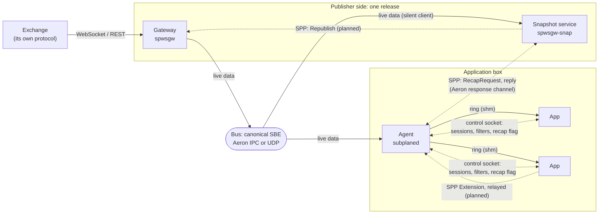
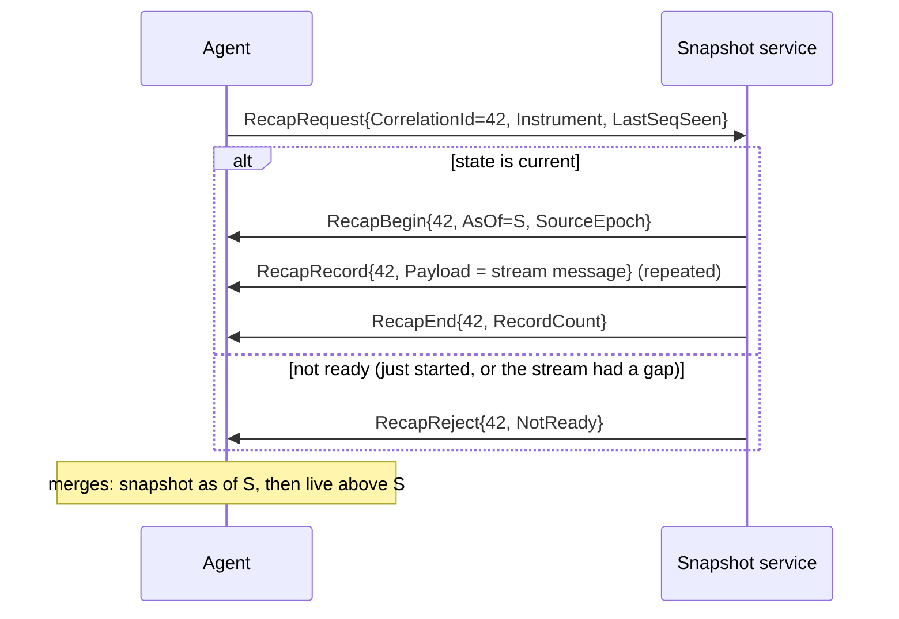
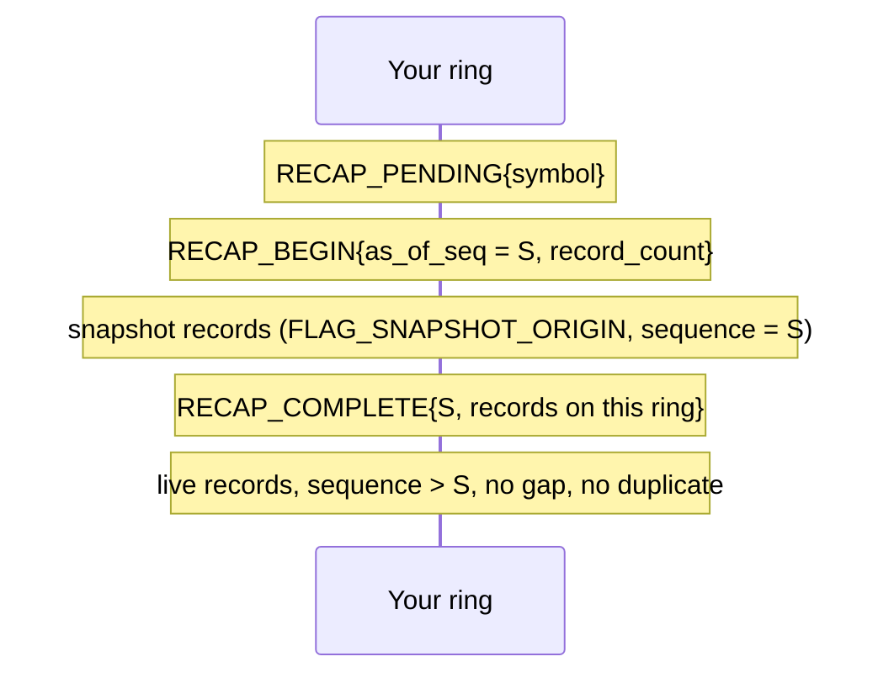

# Developer guide: talking to subplane

Two audiences:
- **Gateway and snapshot-service developers** publish a bus and answer subplane's control messages.
- **App developers** read a ring and ask the agent for what they need.

The normative rules are in `subplane-protocol.md` (SPP). This guide is the walk-through. Items marked (planned) are specified but not built yet.

## The picture

Data flows one way, from the bus to the agent to the apps. Control is a few short conversations, always started by the side that needs something, and always in SPP when it crosses a process boundary between subplane services.



**What travels where:**

| Path | Encoding | Carrier | Who starts it |
|---|---|---|---|
| Live data | the bus schema (canonical SBE, or a firm's own) | Aeron, UDP multicast, TCP | the publisher, continuously |
| Agent to app | the publisher's bytes plus a 64-byte header | shared-memory ring | the agent |
| App to agent | agent control protocol | Unix socket | the app |
| Agent to snapshot service | SPP | Aeron response channel (TCP planned) | the agent, when a session needs state |
| Snapshot service to gateway | SPP | Aeron (planned with feeds step 4) | the snapshot service, after losing state |
| App to service, through the agent | SPP `Extension` | control socket, then Aeron or TCP (planned) | the app |

## For gateway and snapshot-service developers

### 1. Publish the bus
- Publish messages in your schema, back to back per Aeron offer, framed by the schema.
- Every data message carries the routing fields at fixed root offsets: instrument, sequence, exchange timestamp, venue. The canonical schema puts them in one 32-byte prefix.
- Keep one sequence per stream that only goes up.
- Announce your identity: canonical v2's `Heartbeat` will carry `SourceEpoch` and your SPP version (planned).
- For a new schema, use the `subplane-schema-designer` skill.

### 2. Speak SPP
Use the generated codec (`include/subplane/proto/subplane_proto_codec.h`, namespace `sp_proto`), or generate one for your language from `schemas/subplane_proto.xml`. Put a u32 little-endian length before every message you send.

```cpp
uint8_t buf[256];
sp_proto::HelloEncoder hello(buf + 4, sizeof(buf) - 4);
hello.CorrelationId(0).PeerEpoch(start_ns).ProtoVersion(1).MinProtoVersion(1)
     .Role(sp_proto::Role::Snap).ServiceName("spwsgw-snap");
const uint32_t n = static_cast<uint32_t>(hello.finish());   // 0 means it did not fit
std::memcpy(buf, &n, 4);                                     // the binding's length prefix
publication.offer(buf, 4 + n);
```

- Answer every peer's `Hello` with your own.
- Remember the peer's version range and extensions, per peer.
- Answer anything you don't implement with `Status{Unsupported}`, echoing its `CorrelationId`.
- Never close a connection over an unknown message.

### 3. Serve recap (snapshot service)
The snapshot service subscribes to the live stream as a silent, untethered client, rebuilds each instrument's state with the publisher's own rules, and answers:



- **S is a live sequence:** the state contains every live message up to and including S.
- **Records are your stream's messages,** carried as opaque payloads. The agent delivers them to apps unchanged, flagged as snapshot.
- **Replies are contiguous:** don't interleave two replies on one response stream.
- **When to reject:** while your state for the instrument is unknown or stale, reject with `NotReady`. The agent retries with backoff.
- **Agent side:** the merge is implemented. The agent sending `RecapRequest` in SPP is the next step (until then it uses the earlier 64-byte request).

### 4. Handle republish (gateway, planned with feeds step 4)
`Republish{Instrument or 0 for all}` asks the gateway to publish the instrument's state again on the live stream: definitions, then a book clear and full depth. Answer with `Status{Ok}`, or `Busy` when rate-limited. Every subscriber sees the result in band, which is how a snapshot service recovers without a private channel.

### 5. Add an extension (planned)
Pick an id (0x8000 and up for your own deployment; ask for one below 0x8000 in `extensions.md` if it is general). Advertise it in your `Hello`, and handle `Extension{ExtensionId, ExtType, Body}`. The body is yours; give it its own small SBE schema.

## For app developers

Apps never see SPP or Aeron. They read a ring and use the agent's control socket (the SDK: `client/shm_reader.h`, `client/control_client.h`).

### 1. Get data
Create or attach a session (YAML or `ControlClient::create_session`), then poll the ring. Every record is a 64-byte `TickHeader` followed by the publisher's bytes; decode them with your codecs or with the generated views.

### 2. Start from a snapshot: recap sessions
Set `recap: true` (YAML) or `SessionRequest::recap = true`. A recap session needs a symbol list and agent-control events. For each symbol you then see:



- Build your state from the snapshot records, then apply live records.
- On `RECAP_FAILED{status, attempt}` the symbol stays pending and the agent asks again. Keep the symbol marked stale until `RECAP_COMPLETE`.
- Other sessions on the box are never delayed by your recap.

### 3. Ask a service something (planned)
`ControlClient::relay(service, extension_id, ext_type, body, reply_cb, timeout)`:
- The agent forwards your `Extension` to a service declared in its config, if the id is allowed and the service advertised it.
- You get the reply, or `Unsupported`, `Denied` or `Timeout` quickly.
- The agent never reads your body.

### 4. Versions
- Old apps keep working when the agent is upgraded. Agents are upgraded first, then gateways, then apps.
- Skip control codes and message types you don't know.
- Read `payload_len` rather than assuming an event's size.
- Use a new feature only when the agent offers it; a request it doesn't know returns `Unsupported`.

## Message map

| SPP message | Sent by | Answered with |
|---|---|---|
| `Hello` (1) | everyone, on connect and reconnect | `Hello` |
| `Status` (2) | anyone | |
| `RecapRequest` (10) | agent | `RecapBegin`, `RecapRecord`…, `RecapEnd`, or `RecapReject` |
| `Republish` (20) | snapshot service, operator | `Status` |
| `Extension` (900) | app (through the agent), service | `Extension` or `Status`, if reply-expected |

| Ring event | Code | Means |
|---|---|---|
| `RECAP_PENDING` | 0xAA | waiting for a snapshot of the symbol |
| `RECAP_BEGIN` | 0xAB | snapshot records follow, as of S |
| `RECAP_COMPLETE` | 0xAC | snapshot done; live continues from S+1 |
| `RECAP_FAILED` | 0xAD | this attempt failed; the agent retries |
